```{r setup, include=FALSE}
knitr::opts_chunk$set(echo = TRUE, fig.align = 'center')
```

```{r visual-identity, echo=FALSE, results='asis'}
cat('
<!-- 
========================================================================================
  DESIGN & CUSTOM HTML/CSS DEVELOPED BY VITOR BIALETZKI CRISTIANO
  Agronomy Engineer | M.Sc. Student in Genetics and Plant Breeding (UFV)
  Affiliations: DBG-UFV | QGSL Lab | IDATA
========================================================================================
-->

<style>
/* ========================================================= UFV / QGSL — VISUAL IDENTITY ========================================================= */ 
:root { 
  --ufv-red: #780000; 
  --ufv-red-dark: #5c0000; 
  --ufv-gold: #B8860B; 
  --ufv-gold-light: #D9B45B; 
  --ufv-gray: #F5F5F4; 
  --ufv-line: #DEDBD5; 
  --ufv-text: #222222; 
} 

/* Oculta o título, autor e data padrão do YAML */
.title, .author, .date { 
  display: none !important; 
} 

/* ESTILO CLEAN DE LINKS SEM BLOQUEIO DE CAMADAS */
a { 
  color: var(--ufv-red); 
  text-decoration: none;
  font-weight: 600;
  transition: color 0.2s ease;
} 

a:hover { 
  color: var(--ufv-gold); 
  text-decoration: underline;
}

/* Faixa superior vermelha com borda dourada */
.top-header-banner {
  background-color: var(--ufv-red);
  border-bottom: 8px solid var(--ufv-gold);
  position: absolute;
  top: 0;
  left: 0;
  width: 100%;
  height: 180px;
  display: flex;
  justify-content: space-between;
  align-items: center;
  padding: 0 80px; 
  box-sizing: border-box;
}

/* Colunas do cabeçalho */
.banner-logo-left {
  flex: 1;
  display: flex;
  justify-content: flex-start;
  align-items: center;
}

.banner-logo-center {
  flex: 1;
  display: flex;
  justify-content: center;
  align-items: center;
}

.banner-logo-right {
  flex: 1;
  display: flex;
  justify-content: flex-end;
  align-items: center;
}

.top-header-banner img {
  width: auto;
  max-width: 100%;
  object-fit: contain;
}

/* CENTRALIZAÇÃO DE IMAGENS E GRÁFICOS */
.main-container p img, 
figure, 
.figure {
  display: block !important;
  margin-left: auto !important;
  margin-right: auto !important;
  text-align: center !important;
  max-width: 100%;
  height: auto;
}

body { 
  background-color: #FFFFFF; 
  color: var(--ufv-text); 
  font-family: Georgia, "Times New Roman", serif; 
  font-size: 16px; 
  line-height: 1.65; 
} 

/* PARÁGRAFOS JUSTIFICADOS */
p {
  text-align: justify;
}

/* MARGEM ESQUERDA PARA O SUMÁRIO FLUTUANTE */
@media (min-width: 1200px) {
  .main-container { 
    max-width: 900px !important; 
    margin-left: 280px !important;
    margin-right: auto !important;
    padding-top: 215px !important; 
  } 

  /* SUMÁRIO FLUTUANTE NA MARGEM ESQUERDA */
  #TOC {
    position: fixed !important;
    top: 215px !important;
    left: 25px !important;
    width: 230px !important;
    max-height: calc(100vh - 240px) !important;
    overflow-y: auto !important;
    background-color: var(--ufv-gray) !important;
    border: none !important;
    border-left: 5px solid var(--ufv-gold) !important;
    border-radius: 6px !important;
    padding: 16px 18px !important;
    box-shadow: 0 4px 14px rgba(0,0,0,0.06) !important;
    z-index: 900 !important;
    font-family: Georgia, "Times New Roman", serif !important;
  }
}

@media (max-width: 1199px) {
  .main-container {
    max-width: 1000px !important;
    margin: 0 auto !important;
    padding-top: 215px !important;
  }
  
  #TOC {
    position: relative !important;
    top: 0 !important;
    left: 0 !important;
    width: 100% !important;
    margin-bottom: 30px !important;
    background-color: var(--ufv-gray) !important;
    border-left: 5px solid var(--ufv-gold) !important;
    border-radius: 6px !important;
    padding: 16px 18px !important;
    font-family: Georgia, "Times New Roman", serif !important;
  }
}

#TOC ul {
  list-style-type: none !important;
  padding-left: 10px !important;
  margin: 0 !important;
}

#TOC > ul {
  padding-left: 0 !important;
}

#TOC li {
  margin-bottom: 6px !important;
  font-family: Georgia, "Times New Roman", serif !important;
  font-size: 14px !important;
  line-height: 1.4 !important;
}

/* ESCONDE OS SUBNÍVEIS POR PADRÃO */
#TOC li ul {
  display: none;
  padding-left: 12px !important;
  margin-top: 4px !important;
}

/* EXIBE SUBNÍVEIS QUANDO EXPANDIDO */
#TOC li.open > ul {
  display: block;
}

.toc-toggle {
  cursor: pointer;
  display: inline-block;
  margin-right: 6px;
  font-size: 10px;
  color: var(--ufv-gold);
  transition: transform 0.2s ease;
  user-select: none;
}

.toc-toggle.expanded {
  transform: rotate(90deg);
}

#TOC a {
  color: var(--ufv-red) !important;
  text-decoration: none !important;
  font-family: Georgia, "Times New Roman", serif !important;
  font-weight: 600 !important;
}

#TOC a:hover {
  color: var(--ufv-gold) !important;
  text-decoration: underline !important;
}

/* ========================================================= CARTÃO DE METADADOS (CENTRALIZADO) ========================================================= */
.metadata-card {
  background-color: var(--ufv-gray);
  border-left: 6px solid var(--ufv-red);
  border-radius: 6px;
  padding: 32px 36px;
  margin-bottom: 45px;
  box-shadow: 0 4px 18px rgba(0,0,0,0.04);
  text-align: center;
}

.doc-title {
  color: var(--ufv-red);
  font-size: 34px;
  font-weight: 700;
  line-height: 1.2;
  margin: 0 0 8px 0;
  text-align: center;
}

.doc-subtitle {
  color: var(--ufv-gold);
  font-size: 19px;
  font-weight: 600;
  font-family: Arial, sans-serif;
  margin-bottom: 24px;
  text-align: center;
}

.author-block {
  border-top: 1px solid var(--ufv-line);
  padding-top: 20px;
  display: flex;
  flex-direction: column;
  align-items: center;
  gap: 8px;
  text-align: center;
}

.author-name {
  font-size: 20px;
  font-weight: 700;
  color: var(--ufv-red);
  text-decoration: none;
}

.author-name:hover {
  color: var(--ufv-gold);
  text-decoration: underline;
}

.author-credentials {
  font-family: Arial, sans-serif;
  font-size: 14px;
  color: #444444;
}

.advisor-info {
  font-family: Arial, sans-serif;
  font-size: 14px;
  color: #555555;
  margin-top: 2px;
}

.advisor-link {
  color: var(--ufv-text);
  font-weight: 700;
  text-decoration: none;
}

.advisor-link:hover {
  color: var(--ufv-gold);
  text-decoration: underline;
}

/* AFILIAÇÕES MINIMALISTAS E CENTRALIZADAS */
.affiliations-container {
  display: flex;
  flex-direction: column;
  align-items: center;
  gap: 6px;
  margin-top: 14px;
  padding-top: 14px;
  border-top: 1px dashed var(--ufv-line);
  width: 100%;
}

.affil-label {
  font-family: Arial, sans-serif;
  font-size: 12px;
  font-weight: 700;
  text-transform: uppercase;
  letter-spacing: 0.6px;
  color: #666666;
}

.affil-links {
  display: flex;
  align-items: center;
  justify-content: center;
  flex-wrap: wrap;
  gap: 10px;
  font-family: Arial, sans-serif;
  font-size: 13.5px;
}

.affil-link {
  color: var(--ufv-red);
  font-weight: 600;
  text-decoration: none;
}

.affil-link:hover {
  color: var(--ufv-gold);
  text-decoration: underline;
}

.affil-bullet {
  color: var(--ufv-gold);
  font-size: 14px;
  font-weight: bold;
}

/* RODAPÉ DE ASSINATURA EM 3 LINHAS CENTRALIZADAS */
.doc-footer {
  margin-top: 90px;
  padding: 24px 0;
  border-top: 2px solid var(--ufv-gold);
  background-color: #FAF9F7;
  border-radius: 4px;
  width: 100% !important;
  display: flex !important;
  flex-direction: column !important;
  align-items: center !important;
  justify-content: center !important;
  text-align: center !important;
  font-family: Georgia, "Times New Roman", serif !important;
  font-size: 14px;
  line-height: 1.8;
  color: #666666;
}

.doc-footer div {
  text-align: center !important;
  width: 100% !important;
  margin: 0 !important;
}

.doc-footer strong {
  color: var(--ufv-red);
  font-weight: 700;
}

h1 { 
  color: var(--ufv-red); 
  font-size: 32px; 
  font-weight: 700; 
  border-left: 8px solid var(--ufv-gold); 
  padding-left: 16px; 
  margin-top: 55px; 
  margin-bottom: 25px; 
} 

h2 { 
  color: var(--ufv-red); 
  font-size: 25px; 
  font-weight: 700; 
  margin-top: 40px; 
} 

h3 { 
  color: var(--ufv-red); 
  font-size: 20px; 
  font-weight: 700; 
} 

pre { 
  background-color: #181818 !important; 
  color: #F3F1EC; 
  border: none; 
  border-top: 4px solid var(--ufv-gold); 
  border-radius: 4px; 
  padding: 20px 22px; 
  box-shadow: 0 8px 25px rgba(0,0,0,0.10); 
} 

pre code { 
  font-family: "SFMono-Regular", Consolas, "Liberation Mono", monospace; 
  font-size: 13px; 
  line-height: 1.65; 
} 

code { 
  color: var(--ufv-red); 
  background-color: #F5F3EF; 
  border-radius: 3px; 
  padding: 2px 5px; 
} 

pre code { 
  color: #F3F1EC; 
  background: transparent; 
  padding: 0; 
} 

pre:not([class]) { 
  border-left: 4px solid var(--ufv-red); 
} 

.table { 
  border-collapse: collapse; 
  width: 100%; 
  font-family: Arial, sans-serif; 
  font-size: 14px; 
} 

.table th { 
  background-color: var(--ufv-red); 
  color: white; 
  border: none; 
  padding: 10px; 
} 

.table td { 
  padding: 9px 10px; 
  border-bottom: 1px solid var(--ufv-line); 
} 

.table tr:hover { 
  background-color: #FAF7F0; 
} 

blockquote { 
  border-left: 5px solid var(--ufv-gold); 
  background-color: #F8F5ED; 
  color: #555555; 
  padding: 15px 20px; 
} 

hr { 
  border: none; 
  border-top: 2px solid var(--ufv-red); 
  margin: 45px 0; 
} 
</style>

<!-- SCRIPT INTERATIVO PARA EXPANDIR/RECOLHER SUBNÍVEIS DO SUMÁRIO -->
<script>
document.addEventListener("DOMContentLoaded", function() {
  var toc = document.getElementById("TOC");
  if (!toc) return;

  var lis = toc.querySelectorAll("li");
  lis.forEach(function(li) {
    var ul = li.querySelector("ul");
    if (ul) {
      var toggle = document.createElement("span");
      toggle.className = "toc-toggle";
      toggle.innerHTML = "&#9654;";
      
      var link = li.querySelector("a");
      if (link) {
        li.insertBefore(toggle, link);
      } else {
        li.insertBefore(toggle, li.firstChild);
      }

      function toggleSublist(e) {
        if (e) e.stopPropagation();
        var isOpen = li.classList.contains("open");
        if (isOpen) {
          li.classList.remove("open");
          toggle.classList.remove("expanded");
        } else {
          li.classList.add("open");
          toggle.classList.add("expanded");
        }
      }

      toggle.addEventListener("click", toggleSublist);

      if (link) {
        link.addEventListener("click", function() {
          if (!li.classList.contains("open")) {
            li.classList.add("open");
            toggle.classList.add("expanded");
          }
        });
      }
    }
  });
});
</script>

<div class="top-header-banner">
<div class="banner-logo-left"></div>
<div class="banner-logo-center"></div>
<div class="banner-logo-right"></div>
</div>

<div class="metadata-card">
<div class="doc-title">TITLE</div>
<div class="doc-subtitle">SUBTITLE</div>
<div class="author-block">
<div><a href="https://www.linkedin.com/in/vitor-bialetzki-cristiano-3b22431a8/" class="author-name">Vitor Bialetzki Cristiano</a></div>
<div class="author-credentials">Agronomy Engineer &ndash; CREA-MG n&ordm; 000462643-5 &nbsp;|&nbsp; M.Sc. Student in Genetics and Plant Breeding &ndash; UFV</div>
<div class="advisor-info">Advisor: <strong><a href="https://scholar.google.com.br/citations?user=KS9I5bQAAAAJ&hl=pt-BR" class="advisor-link">Prof. Dr. Kaio Olimpio</a></strong></div>
<div class="affiliations-container">
<div class="affil-label">Affiliations</div>
<div class="affil-links">
<a href="https://dbg.ufv.br/" class="affil-link">DBG-UFV</a>
<span class="affil-bullet">&bull;</span>
<a href="https://lab-qgsl-ufv.vercel.app" class="affil-link">QGSL Lab</a>
<span class="affil-bullet">&bull;</span>
<a href="https://idata.ufv.br/" class="affil-link">IDATA</a>
</div>
</div>
</div>
</div>
')
```

# 1. INTRODUÇÃO

A recomendação de cultivares em programas de melhoramento genético vegetal exige abordagens estatísticas robustas capazes de lidar com a interação genótipo x ambiente ($G \times A$). No contexto do milho tropical (*Zea mays L.*), a variabilidade climática e a heterogeneidade ambiental das regiões produtoras brasileiras impõem desafios adicionais para a seleção de híbridos estáveis e adaptados.

## 1.1 Contextualização e Relevância

O emprego de dados provenientes de ensaios multiambientais (METs) permite avaliar a produtividade de grãos e outros caracteres agronômicos de interesse. Contudo, os métodos tradicionais frequentistas muitas vezes enfrentam limitações no tratamento de desbalanceamentos e na incorporação de informações *a priori*.

## 1.2 Objetivos

* **Objetivo Geral:** Desenvolver e avaliar um arcabouço analítico baseado em estatística bayesiana para a recomendação precisa de variedades de milho tropical.
* **Objetivos Específicos:**
  1. Estimar parâmetros genéticos via cadeias de Markov Monte Carlo (MCMC).
  2. Avaliar a estabilidade e adaptabilidade dos híbridos sob diferentes cenários de prioris.
  3. Comparar a eficiência preditiva dos modelos bayesianos em relação aos métodos tradicionais.

---

# 2. REFERENCIAL TEÓRICO

## 2.1 Genética Quantitativa no Melhoramento de Milho

A seleção de genótipos superiores baseia-se na decomposição da variação fenotípica observada em componentes genéticos e ambientais. A acurácia seletiva depende diretamente do controle do erro experimental e da modelagem adequada dos efeitos aleatórios.

## 2.2 Inferência Bayesiana Aplicada

A abordagem bayesiana combina a função de verossimilhança dos dados observados com distribuições de probabilidade *a priori* sobre os parâmetros, resultando na distribuição posterior.

### 2.2.1 Especificação de Prioris Informativas e Não-Informativas

A escolha da distribuição *a priori* para os componentes de variância (como a Gama Inversa ou Half-Cauchy) exerce papel fundamental na regularização das estimativas, especialmente em cenários com pequenos tamanhos de amostra ou alto desbalanceamento.

### 2.2.2 Métodos MCMC e Diagnósticos de Convergência

O Amostrador de Gibbs (*Gibbs Sampling*) e o algoritmo Metropolis-Hastings são amplamente utilizados para amostrar da distribuição posterior marginal. A avaliação de convergência exige o diagnóstico via testes como Gelman-Rubin e Geweke, além do tamanho efetivo de amostra ($ESS$).

---

# 3. MATERIAIS E MÉTODOS

## 3.1 Conjunto de Dados Experimentais

Os dados foram obtidos a partir de ensaios de competição de híbridos de milho tropical conduzidos no estado de Minas Gerais em diferentes safras. As variáveis mensuradas incluem:

* **Rendimento de Grãos (RG):** medido em $kg \cdot ha^{-1}$ e corrigido para 13% de umidade.
* **Altura de Planta (AP) e Inserção de Espiga (AE):** mensuradas em centímetros.
* **Acamamento e Quebramento:** percentual de plantas acamadas/quebradas na colheita.

## 3.2 Estrutura do Modelo Estatístico

O modelo estatístico bayesiano empregado para a análise conjunta é dado por:

$$y_{ijk} = \mu + e_i + g_j + (ge)_{ij} + b_{k(i)} + \varepsilon_{ijk}$$

Em que:
* $y_{ijk}$ é a resposta fenotípica observada;
* $\mu$ é a média geral;
* $e_i$ é o efeito fixo do ambiente $i$;
* $g_j$ é o efeito aleatório do genótipo $j \sim \text{N}(0, \sigma_g^2)$;
* $(ge)_{ij}$ é o efeito aleatório da interação $G \times A \sim \text{N}(0, \sigma_{ge}^2)$;
* $b_{k(i)}$ é o efeito aleatório do bloco $k$ dentro do ambiente $i$;
* $\varepsilon_{ijk}$ é o erro residual aleatório $\sim \text{N}(0, \sigma_e^2)$.

---

# 4. RESULTADOS E DISCUSSÃO

## 4.1 Convergência e Validação do Modelo

As cadeias MCMC foram rodadas com $100.000$ iterações, *burn-in* de $10.000$ e *thinning* igual a $10$. Todos os diagnósticos confirmaram a convergência dos parâmetros com valores de $\hat{R} < 1.05$ e tamanho efetivo de amostra satisfatório.

## 4.2 Estimativas de Parâmetros Genéticos

```r
# Exemplo de código R para verificação da saída
summary(cars)

```{r footer-signature, echo=FALSE, results='asis'}
cat('
<div class="doc-footer" style="display: flex !important; flex-direction: column !important; align-items: center !important; text-align: center !important; width: 100% !important;">
  <div style="text-align: center !important;">HTML/CSS layout and structure developed by <strong>Vitor Bialetzki Cristiano</strong> &copy; 2026</div>
  <div style="text-align: center !important;"><a href="mailto:vitor.cristiano@ufv.br" style="color: var(--ufv-red); font-weight: 600; text-decoration: none;">vitor.cristiano@ufv.br</a></div>
  <div style="text-align: center !important;"> UFV / DBG / QGSL / IDATA &bull; All rights reserved.</div>
</div>
')
```